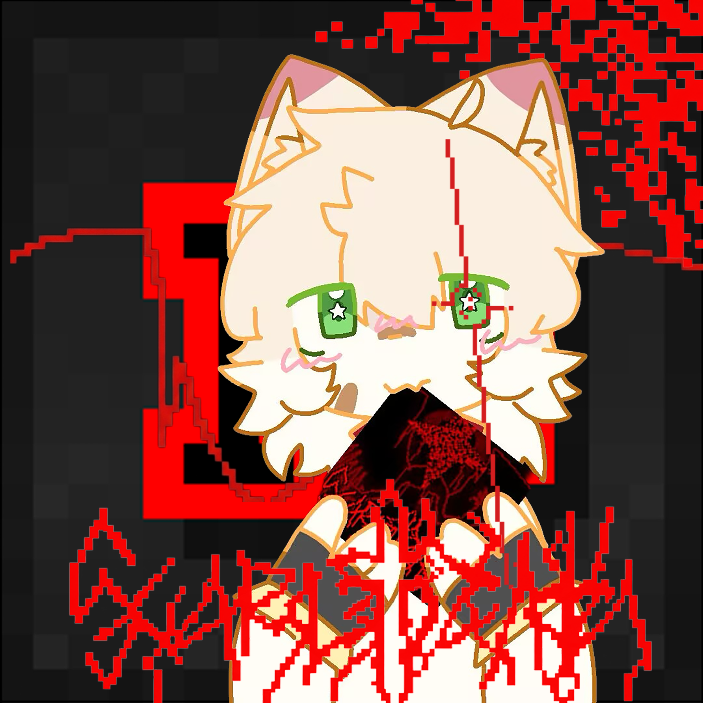

<p align="center">
  
</p>

<h1 align="center">KuroakiGimmick</h1>

<p align="center">
  为《vivid/stasis》制作的谱面演出预览与编辑工具。<br>
  在同一条时间轴上编排 gimmick、图片、字幕、场景效果和窗口运动，并在歌曲场景中检查实际表现。
</p>

<p align="center">
  
  
  
  
  
</p>

<p align="center">
  <a href="#项目定位">项目定位</a> ·
  <a href="#功能">功能</a> ·
  <a href="#快速开始">快速开始</a> ·
  <a href="#编辑与导出">编辑与导出</a> ·
  <a href="#构建与发布">构建与发布</a> ·
  <a href="#开发与文档">开发与文档</a> ·
  <a href="#特别感谢">特别感谢</a>
</p>

<table align="center">
  <tr><th align="center">macOS</th><th align="center">Windows</th><th align="center">Linux</th></tr>
  <tr>
    <td align="center">Metal / SDL3 GPU<br>Apple Silicon 已实际使用</td>
    <td align="center">Direct3D 12 / SDL3 GPU<br>需要可用的 D3D12 设备</td>
    <td align="center">暂无交互式图形后端<br>不列为支持平台</td>
  </tr>
</table>

> [!IMPORTANT]
> 本仓库只提供 **KuroakiGimmick 的源码、应用资源及可公开分发的第三方组件**。
> 《vivid/stasis》的游戏素材不会随仓库分发。完整场景预览及部分功能需要自行准备合法取得的本地游戏资源。

## 项目定位

**KuroakiGimmick（K/G）** 主要解决的是《vivid/stasis》的 **谱面演出制作、预览与验证**。

它将音符、HUD、VSM gimmick、图片、字幕、Custom Proxy 和窗口事件放进同一套时间轴与歌曲场景中。与其每改一个参数就进游戏重新检查，不如先在编辑器里定位、预览、调整，再把结果导出去。

项目并不是完整的音符制谱器，也不打算重新实现整个 GameMaker Runtime。对于无法完整模拟的原生行为，K/G 会尽量提供兼容实现及诊断信息；真正的结果仍然以游戏本体为准。

这一点很重要。**能把场景渲染出来，不代表每一种 gimmick 都已经正确还原。**

## 功能

| 功能 | 支持内容 |
| --- | --- |
| **谱面与演出预览** | 读取 VSB / VSC、VSM、VSP、SGV 及相关图片、音频和字幕；在 GAME SCENE 中预览 Note、Lane、HUD、判定与演出。 |
| **时间轴编辑** | 编辑事件时间、持续时间、From / To、Easing 和 Proxy；支持吸附、循环试听、时间标记、批量操作、Loop 拆分／合并、撤销与重做。 |
| **图片动画** | IMAGE CANVAS 编辑初始姿态、位置、缩放、旋转、透明度、关键帧、运动路径与资源替换。 |
| **文字与字幕** | TEXT CANVAS 编辑多行文字、排版、RGB 颜色、对齐、换行宽度及 MOVE / FADE 动画。 |
| **直接场景编辑** | 在 GAME SCENE 双击图片或文本对象并拖动修改 X/Y；编辑手柄不受场景后处理影响。 |
| **场景与原生演出** | Custom Proxy、图片 Layer、Film、粒子、Room FX、Shader、Note 位移，以及部分 Custom / 原生 gimmick。 |
| **窗口演出** | 虚拟桌面、真实辅助窗口、部分 ExtCustomGimmick 窗口事件、Proxy 内容绑定与多窗口预览。 |
| **Custom Episode** | 将 `custom_episode` 剧情数据展开到时间轴，配合播放、定位、截图和视频输出进行检查。 |
| **工程与导出** | 保存 SGV；导出 VSM、VSM + cgmk config、VSP + assets、Chart Folder、Info Card 或 MP4。 |
| **工作区与工具** | 中文／English、界面设置、F1 离线参数文档、轨道说明、跨实例选择集复制，以及命令行检查／渲染。 |
| **Optimization Engine** | Rust 负责解析、BPM、音符运动、音频解码和 Timeline 基础轨道批量求值；保留 C# 兼容路径与诊断开关。 |

K/G 的重点是**演出**，而不只是把 VSM 文本换一种方式显示出来。预览与视频输出尽可能共用相同的主要渲染流程，但这不等于真实窗口、操作系统桌面和游戏原生状态都会被录进视频。

## 快速开始

### 环境要求

| 项目 | 要求 |
| --- | --- |
| .NET | .NET 8 SDK，或能够构建 `net8.0` 的后续 SDK |
| Rust | stable 工具链（rustup / cargo / rustc），用于 Optimization Engine 和正式发行构建 |
| macOS | Metal，使用 SDL3 GPU |
| Windows | Direct3D 12，使用 SDL3 GPU |
| 游戏素材 | 用户自行准备的本地 `Assets/`；仓库内 `Assets/App/` 仅为应用自身资源 |
| 音频 | Symphonia 负责支持的格式；兼容路径仍可使用内置 NVorbis |
| 视频与部分兼容解码 | FFmpeg，可通过 `PATH` 或 `KUROAKI_FFMPEG` 指定 |

首次恢复 NuGet 包需要网络连接。

**编译通过不等于运行通过。** 这不是文字游戏，尤其在 GPU 驱动开始闹脾气的时候。

### 编译

在仓库根目录执行：

```bash
dotnet restore KuroakiGimmick.csproj --locked-mode
bash scripts/build-rustbridge.sh
```

Windows PowerShell：

```powershell
dotnet restore KuroakiGimmick.csproj --locked-mode
pwsh -File scripts/build-rustbridge.ps1
```

构建脚本会编译 C# 与 Rust、复制对应原生库并运行四项不需要 SDL 窗口的自测。

如果只需要 C# 兼容路径，也可以构建托管程序：

```bash
dotnet build KuroakiGimmick.csproj -c Release --no-restore
```

没有匹配的 `kg_native_core` 原生库时，默认模式会记录原因并回退；要求必须启用 Rust 的模式则不会悄悄回退。

### 启动

```bash
dotnet run --project KuroakiGimmick.csproj -c Release --no-build
```

打开指定 SGV 工程：

```bash
dotnet run --project KuroakiGimmick.csproj -c Release --no-build -- \
  --editor /path/to/project.sgv.json
```

macOS 启动脚本：

```bash
bash scripts/run-editor.command /path/to/project.sgv.json
```

Windows PowerShell：

```powershell
.\scripts\run-editor.ps1 -Project 'C:\Charts\project.sgv.json'
```

界面语言可在 **SETTINGS / 设置 → Language** 中选择跟随系统、中文或 English。语言设置只影响应用界面，不会改写工程中的字幕内容、谱面标识符或原始数据。

## 编辑与导出

常用流程并不复杂：

1. **打开谱面或工程**：通过 `OPEN CHART / VSM` 导入 VSB、VSC、VSM、SGV 或歌曲目录，也可以拖入对应文件。需要额外素材时使用 `+ FILES / RESOURCES`。
2. **编辑演出**：按 `Tab` 在 Viewer / Editor 间切换；在时间轴中修改事件，并用 `IMAGES`、`TEXT`、`SCENE` 检查图片、字幕和实际歌曲场景。
3. **保存工程**：使用 `SAVE / SAVE AS` 保存 `.sgv.json`。SGV 可以引用外部资源，移动工程时请一并保留对应资源及相对路径。
4. **检查并导出**：先用 `REVIEW FILES` 查看输出文件与警告，再执行 `EXPORT COPY`。默认不覆盖既有导出文件。

### 编辑器的一些细节

- **时间轴**：可以拖动轨道名称或手柄调整显示顺序；图片和文字组会整体跟随，轨道显示顺序不会改变实际事件执行顺序。一次完整拖动对应一次 Undo。
- **跨实例复制**：选择集可以通过系统剪贴板在两个 K/G 实例之间传递，也可作为文本发送。
- **谱面兼容**：读取 CSM 3.4.0 VSC 的 `modExtra` 字段时会保留原始元数据与格式，不会把旧 VSC 自动升级成新版方言；同难度 VSM 缺失时仍可按现有规则回退到 `GLOBAL.vsm`。
- **F1 文档**：正文支持 Markdown 表格、行内代码、粗体、强调、删除线与代码围栏；宽表格在窄窗口中按字段展开，代码复制保留原文。可运行 `--reference-layout-test` 在无窗口环境检查文档解析与排版。
- **搜索**：添加 gimmick 页面的搜索框跟随设置中的 Inline / Modal 输入模式；Inline 实时筛选，Enter 提交，Esc 取消当前输入。
- **IMAGE CANVAS**：`INITIAL` 修改初始姿态，`KEY HERE` 写入当前时间点，`START / END` 与 `CONTINUE` 用于运动路径和动画端点。
- **TEXT CANVAS**：文字内容和视觉动画分别编辑；支持 `MOVE`、`FADE IN`、`FADE OUT`，以及多行、对齐、行距、RGB 颜色和自动换行。
- **GAME SCENE**：可直接双击并拖动图片或文字对象修改当前拍的 X/Y。拖动松手时只提交一次 Undo；动态值、冲突状态或不安全的变换仍需使用原始编辑方式。
- **Proxy 辅助显示**：选择 P 编号或 `pr*/sh*` 事件后，默认显示逻辑网格和轨道参考框；“完整取景框”可额外显示包含背景／UI 的取景区域。隐藏的 Proxy 只显示状态提示，不画可见轨道框。PR 网格显示时可双击轨道参考区域选中 Proxy；普通双击优先选择图片／文字，`Shift + 双击` 可穿过图片直接选 Proxy。重叠时优先选择最上层且未被遮盖的轨道，隐藏 Proxy 不参与命中。也可点击画面中的编号或 `< / >` 切换目标；浮窗的 `20px` 切换 10／5／20 间距，`[+]` 展开数值。遮盖斜线和渐变边界按完整 `320×180` 源图的 UV 计算。
- **Proxy 单独预览**：点击浮窗中的“全部 Proxy（点击隔离）”切换为“只看 Pn”，检查这一份 Proxy 实际合成的内容；再点一次恢复全部。Base／Custom Proxy 使用同一套源画面、变换和场景后处理，固定连击等 HUD 不属于单个 Proxy。“只看”只是编辑器视图，不改 PRA、谱面文件、窗口输出或视频导出。
- **Custom Episode**：播放、反向定位、截图和视频导出尽可能保持一致。需要特殊游戏状态或不能复现的剧情步骤会给出诊断信息。
- **Window Movement**：真实辅助窗口依赖目标操作系统；虚拟桌面、窗口位置以及多个真实原生窗口不会合成为普通视频的单一画面。

### 导出格式

| 模式 | 输出 |
| --- | --- |
| **VSM** | 当前演出文本 |
| **VSM + cgmk config** | VSM 及其窗口配置 |
| **VSP + assets** | VSP 与实际引用的图片资源 |
| **Chart Folder** | 当前难度的谱面演出、VSP、图片、字幕等资源，以及可重新打开的预览工程 |
| **Info Card** | 当前难度的 16:9 乐曲信息卡片 |
| **Video** | H.264 / AAC MP4，录制歌曲场景 |

**VSP + assets** 只收集 VSP 真正引用的图片，保留可用的原文件名并改写为可移动的相对路径；可以选择图片与 VSP 同目录，或放入 `Assets/`。它不会顺手把 VSM、音频与整个谱面目录一起塞进去。

**Chart Folder** 只收集当前难度真正需要的文件，不复制其它难度、未引用素材或 `.kuroaki` 备份。工程备份仍保留在原工程旁的 `.kuroaki/`；导出不负责安装游戏扩展，也不会修改原歌曲目录。

**Info Card** 支持不同输出分辨率；**Video** 的普通歌曲场景与真实窗口演出是两回事，后者仍应在目标系统检查。

设置中的 **Overwrite exports / 允许导出覆盖文件** 默认为关闭。开启后同名文件会在成功导出时替换；Chart Folder 会按文件合并而不是删除其它未导出文件，原谱面源文件仍受保护。命令行可使用 `--overwrite` 单次允许覆盖。

### 常用快捷键

| 快捷键 | 操作 |
| --- | --- |
| `Tab` | Viewer / Editor 切换 |
| `Space` | 播放 / 暂停 |
| `Ctrl/⌘ + O` | 打开 |
| `Ctrl/⌘ + S` | 保存 |
| `Ctrl/⌘ + Shift + S` | 另存为 |
| `Ctrl/⌘ + Z` | 撤销 |
| `Ctrl/⌘ + Shift + Z` | 重做 |
| `Ctrl/⌘ + C / V` | 复制／粘贴选择集 |
| `E` / `Shift + E` | 创建或激活时间标记／取消固定标记 |
| `A` / `B` / `L` | 设置循环起点／终点／开关循环 |
| `F1` | 打开离线手册 |
| 长按 `W` | 查看轨道详细说明 |
| `Esc` | 取消当前操作／关闭真实窗口预览 |

## 引擎与诊断

v0.1.5 / Build 18.0 起，K/G 使用 **Optimization (Rust)** 承担一部分性能敏感的计算。当前原生 crate 版本为 `0.3.0-alpha.0`：

- Rust：VSC / VSB / VSM 解析、BPM 构建、音符运动、Symphonia 音频解码及 Timeline 基础轨道批量求值；
- C#：事件语义、回调、逐帧绑定、编辑模型、SDL 播放和 GPU 渲染；
- 两者提供兼容回退与一致性验证路径，但并不意味着所有逻辑都转到了 Rust。

可在 **设置 → Performance** 中调整优化引擎及音频路径，重新打开谱面后生效；环境变量的优先级高于设置。

| 开关 | 用途 |
| --- | --- |
| `KG_RUST_ENGINE=auto\|off\|verify\|required` | 控制解析、BPM、Timeline；`verify` 对比两套结果，`required` 禁止静默回退。 |
| `KG_RUST_BRIDGE` | 单独控制音符运动；未设置时跟随计算引擎配置。 |
| `KG_AUDIO_ENGINE=optimization\|nvorbis` | 选择音频路径。 |
| `KG_RUST_AUDIO_REQUIRED=1` | 要求 Rust 音频路径必须可用。 |

`verify` 是一致性检查，不适合拿来跑性能基准。音频缓存、并行加载、原生库位置以及 ABI 说明见下方的 [技术文档](#开发与文档)。

VSM 行尾 `//` 注释可以读取，但会产生 warning；C# 和 Rust 会报告一致的诊断。送回原游戏前仍应移除这些注释。独立注释行与裸 `mods` 标记的兼容性错误诊断仍然保留。

### 命令行

<details>
<summary>检查、乐曲卡片、截图与视频渲染</summary>

查看完整参数：

```bash
dotnet run -c Release --no-build -- --help
```

检查谱面指定时间点：

```bash
dotnet run -c Release --no-build -- \
  --inspect /path/chart.vsb --time 45
```

生成乐曲信息卡片：

```bash
dotnet run -c Release --no-build -- \
  --card /path/FINALE.vsb --out card.png --width 1920
```

卡片宽度可选 `1280`、`1920`、`2560`、`3840`。

截图：

```bash
dotnet run -c Release --no-build -- \
  --snapshot /path/project.sgv.json --scene --time 45 \
  --out frame.ppm --report frame.json --strict
```

视频导出：

```bash
dotnet run -c Release --no-build -- \
  --render /path/project.sgv.json --start 30 --end 45 \
  --fps 60 --width 1920 --out clip.mp4 --strict
```

`--strict` 会将对应渲染错误作为命令失败返回。截图和视频渲染需要可用的 GPU 后端；`--inspect` 不能代替图形兼容性验证。

单次设置语言可传入 `--language zh-CN`、`--language en` 或 `--language auto`。实际支持的参数始终以 `--help` 为准。

</details>

## 构建与发布

当前应用版本为 **v0.1.5 / Build 18.0.1**；最终版本号以 [`KuroakiGimmick.csproj`](KuroakiGimmick.csproj) 为准。

发行脚本会为目标 RID 编译、打包匹配架构的 `kg_native_core` 库。跨架构构建 Rust 时还需要对应 target 与链接器；不要把能交叉编译 C# 误当成原生库也自动跟着跨平台了。

### .NET 发行包

macOS：

```bash
# arm64 / x64 / all
bash scripts/publish-mac.sh arm64
```

从 macOS 构建 Windows .NET 单文件版本：

```bash
# x64 / arm64 / all
bash scripts/publish-win.sh x64
```

Windows PowerShell：

```powershell
.\scripts\publish-windows.ps1 -Arch x64
```

输出目录类似：

```text
dist/
└── KuroakiGimmick-v0.1.5-<RID>-18.0.1-<timestamp>/
```

同时生成对应 ZIP；使用 `all` 会分别构建两个架构，macOS 不自动生成 Universal Binary。

### NativeAOT

K/G 也支持 NativeAOT 发行：

```bash
# macOS，必须在目标 macOS 环境构建
bash scripts/publish-aot-mac.sh arm64

# Windows，必须在目标 Windows 环境构建
bash scripts/publish-aot-win.sh x64
```

Windows NativeAOT 还需要相应架构的 Visual Studio C++ Build Tools。NativeAOT 输出包含原生可执行文件、SDL3、shaderc、SPIRV-Cross、Rust Optimization Engine 和其它必需原生库，**不能只拿走一个可执行文件**。

直接执行 `dotnet publish -c Release -r <rid>` 时，Release + RID 默认选择 NativeAOT，但不会自动编译或复制 Rust 原生库；正式发行请使用对应脚本。需要原有的 .NET 单文件模式时可显式指定 `-p:PublishAot=false -p:PublishSingleFile=true`。普通 `dotnet build` 不受该默认值影响。

macOS 构建在条件允许时使用 ad-hoc 签名，不执行 Apple notarization。

发布包中只应包含有权分发的内容。K/G 不会把原版游戏资源变成可以任意再分发的资源。

## 开发与文档

### 项目结构

```text
KuroakiGimmick/
├── .github/workflows/         CI 与发布
├── src/
│   ├── App/                   入口与应用状态
│   ├── Bridge/                C# / Rust 桥接
│   ├── Core/                  解析、模型、编辑、Timeline、导出
│   ├── Graphics/              场景、特效、文字、SDL3 GPU
│   ├── Native/                原生平台接口
│   └── UI/                    Viewer、Editor、菜单、本地化
├── rust/kg-native-core/       Optimization Engine
├── Assets/App/                应用自身素材
├── Resources/Fonts/           界面字体
├── ThirdParty/                第三方声明与相关资源
├── docs/                      开发与优化引擎文档
├── scripts/                   构建、发布与资源处理脚本
├── KuroakiGimmick.csproj
├── CHANGELOG.md
└── THIRD_PARTY_NOTICES.md
```

公开仓库不包含本地游戏资源、`Samples/`、`Integrations/`、构建产物或单独的本地测试工作区。Rust 单元测试与程序内置的无窗口自测仍然保留；CI 在 Windows / macOS 上执行相关检查。

### 技术文档

- [更新日志](CHANGELOG.md)
- [Rust Optimization Engine：开关、构建与发布](docs/OPTIMIZATION_ENGINE.md)
- [音符运动与 ABI](docs/RUSTBRIDGE.md)
- [谱面解析与 BPM](docs/RUSTBRIDGE_ENGINE.md)
- [Timeline Runtime](docs/RUST_RUNTIME_V030.md)
- [第三方许可证与声明](THIRD_PARTY_NOTICES.md)
- [字体资源说明](Resources/Fonts/README.md)

K/G 内置的 F1 文档用于谱师查看 gimmick 与操作说明；开发文档则解释渲染、原生桥接和运行路径。两者不是一回事。

### 兼容性边界

K/G **不会执行任意 GML**，也不完整模拟 GameMaker。以下内容可能只能部分预览：

- 依赖原游戏运行时内部状态、特定游戏版本或专用场景的逻辑；
- 尚未实现的原生对象、动态实例或特殊回调；
- 与操作系统窗口生命周期强绑定的行为；
- 尚未适配的 Custom / ExtCustom gimmick。

建议通过时间轴、`SCENE`、兼容性诊断信息以及最终游戏实机共同验证。遇到两边不一致，**游戏本体说了算**。

### 游戏资源与许可证

公开仓库的 `Assets/App/` 只包含 K/G 自身使用的图标等应用资源。游戏图像、音符皮肤、音频、谱面、演出素材等必须由用户自行准备合法取得的本地副本。

KuroakiGimmick 与《vivid/stasis》开发团队不存在官方隶属、合作或背书关系。项目源码的使用、修改与再分发应以仓库实际提供的项目级许可或权利人授权为准；第三方组件、字体和游戏内容仍遵循各自的许可证与版权要求。仓库公开不等于所有依赖素材都可以随意再分发。

## 特别感谢

### [Dawn Hisomeru](https://github.com/MalNEW)

感谢提供的大量**鬼点子**、早期测试反馈，以及关于 Editor 的各种意见和建议。

很多东西能变成现在这个样子，大概有一部分责任确实得算在这里。

### [Bingshuang412](https://github.com/Frollsy)

感谢提供 `custom_episode` 以及更多 gimmick 的**设计思路与方案**，以及开发过程中的 Bug 反馈、使用意见和功能建议。

### vivid/stasis 交流群

感谢所有用过 KuroakiGimmick、提出建议、帮忙测试、踩过边界问题，以及把程序炸掉之后还愿意回来提供复现步骤和日志的人。

这些反馈真的帮了很多。

### GPT-6 Astra、Claude Opus 5、GPT-5.6 Sol

感谢在开发、调试、研究、设计，以及大量脑暴过程中提供的帮助。

**AI 真的太好用了，你们知道吗。**

### DawnGPT

感谢一路提供的各种鬼点子、技术建议、设计反馈，以及 KuroakiGimmick 开发过程中的支持。

### vivid/stasis

感谢 hajimeli 以及参与制作《vivid/stasis》的开发者与创作者。

K/G 是独立的非官方社区项目。《vivid/stasis》及其游戏内容的相关权利归各自权利人所有。

最后，也感谢所有在 KuroakiGimmick 还没完全准备好的时候，就敢点开它的人。

至少程序炸掉以后，我们通常还能得到一份日志。

通常。
